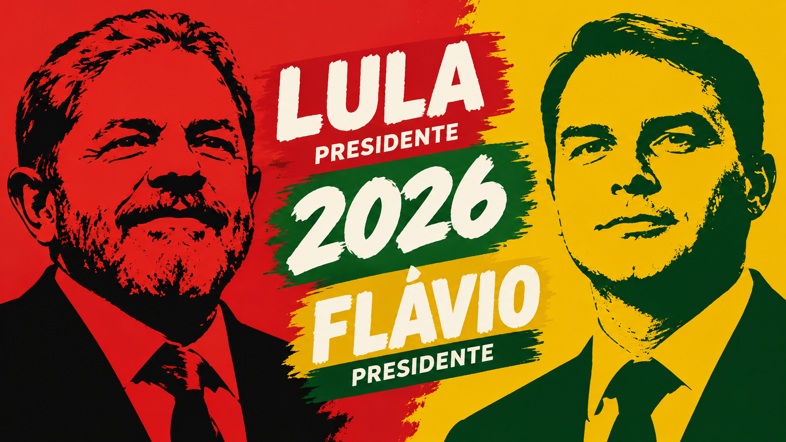

# Perfis em foco: Lula e Flávio Bolsonaro

<p align="center">
	
</p>

Projeto educacional em desenvolvimento para praticar HTML, CSS e JavaScript por meio de perfis informativos de Luiz Inácio Lula da Silva e Flávio Bolsonaro. A página permite alternar entre os perfis e reúne links para fontes externas. O conteúdo pode ser atualizado conforme novas fontes forem verificadas.

## Funcionalidades

- Alternância entre os perfis pelos números 13 e 22.
- Atualização da foto, do nome, dos fundos responsivos e dos links conforme o perfil selecionado.
- Reprodução do áudio correspondente ao perfil após a troca.
- Fundo mobile e desktop para cada perfil.
- Animação de luz ao redor da foto.
- Mensagem alternativa quando uma imagem não carrega.
- Links apresentados em botões e atalhos com ícones.

## Tecnologias

- HTML5
- CSS3
- JavaScript puro
- [Ionicons](https://ionic.io/ionicons)

## Executar localmente

1. Abra a pasta `projeto-final` no Visual Studio Code.
2. Abra `index.html` com a extensão Live Server.

É necessária uma conexão com a internet para carregar os ícones do Ionicons e abrir os links externos.

## Estrutura

```text
projeto-final/
├── assets/                 # Imagens, áudios e capa do README
├── index.html              # Estrutura da página
├── script.js               # Alternância de perfil, links e áudio
├── style.css               # Estilos, fundos responsivos e animações
└── README.md               # Apresentação pública do projeto
```

## Observação

Este projeto é um exercício de aprendizagem, não uma declaração de apoio político. A capa é uma arte conceitual e não confirma candidaturas oficiais. As informações devem ser consultadas nas fontes externas e verificadas antes de serem consideradas atuais.
